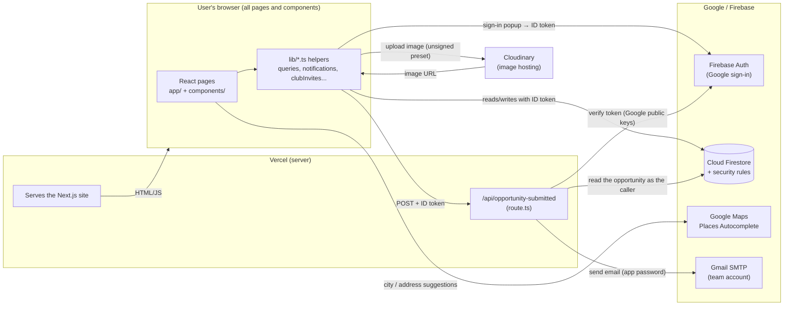

# How CoSync Works

A guide to the CoSync codebase for someone who didn't write it. Everything below comes from reading the code. File paths are given so you can check each claim. Where something looks unfinished or unclear, the guide says so.

> **One important caveat up front:** `firestore.rules` is listed in `.gitignore`, and its own header says it is copied into the Firebase Console by hand ("Not deployed via the Firebase CLI"). That means **the rules described here are the local copy. They may not exactly match what is live.** Every "who can read/write" statement below is only as true as that copy.

---

## Contents

1. [Overview](#1-overview)
2. [Tech stack](#2-tech-stack)
3. [How the pieces connect](#3-how-the-pieces-connect)
4. [Data: every Firestore collection](#4-data-every-firestore-collection)
5. [Every feature, step by step](#5-every-feature-step-by-step)
6. [Safety and privacy for teen users](#6-safety-and-privacy-for-teen-users)
7. [Limitations](#7-limitations)
8. [Glossary](#8-glossary)

---

## 1. Overview

**What it is:** CoSync is a website where middle and high school students who like building things can:

- show their projects
- keep a "build journal" of progress updates
- find teammates
- join clubs
- find opportunities like hackathons, research roles and programs

The landing page calls it "A home for young makers" (`app/page.tsx`).

**Who it's for:** There are two kinds of account, chosen during onboarding (`app/onboarding/page.tsx`):

- **Students** (grades 6–12) post projects, journal their builds and join clubs.
- **Educators** post opportunities and mentor students through public threads. An educator starts out "unverified" until the team manually confirms them.

The code also defines `guardian` and `admin` roles (`lib/types.ts`). No screen ever assigns `guardian`. `admin` is only used by the security rules for opportunity moderation.

### The pages (every route in `app/`)

In Next.js, each folder in `app/` that contains a `page.tsx` file becomes a URL. A folder name in `[brackets]` is a **dynamic segment**: it stands in for a value such as an ID.

| URL | File | What it shows | Sign-in needed? |
|---|---|---|---|
| `/` | `app/page.tsx` | Landing page: pitch, "Get started with Google" button, and a strip of recent build-journal updates | No. Signed-in visitors are redirected away |
| `/onboarding` | `app/onboarding/page.tsx` | Two-step setup: student or educator, then interests, school and gender | Yes |
| `/home` | `app/home/page.tsx` | Personal feed (For you / Following / Opportunities / Nearby) plus a sidebar with upcoming club events and "You might follow" | Yes |
| `/discover` | `app/discover/page.tsx` | Browse and search other people's public projects | Yes |
| `/projects` | `app/projects/page.tsx` | Your own projects and the ones you contribute to, plus "New project" | Yes |
| `/projects/[projectId]` | `app/projects/[projectId]/page.tsx` | One project: header, cover photo, build journal, team, open roles, links | Yes |
| `/clubs` | `app/clubs/page.tsx` | Your clubs, clubs you can join, "Start a club", "Join club via code" | Yes |
| `/clubs/[clubId]` | `app/clubs/[clubId]/page.tsx` | One club: discussions, events, members, sidebar | Yes |
| `/opportunities` | `app/opportunities/page.tsx` | Directory of approved opportunities with filters, plus "Add opportunity" | Yes |
| `/saved` | `app/saved/page.tsx` | Opportunities you bookmarked | Yes |
| `/profile/[uid]` | `app/profile/[uid]/page.tsx` | A person's profile: bio, interests, projects, pins, followers | Yes |
| `/notifications` | `app/notifications/page.tsx` | Your inbox: invites, replies, mentions, follows | Yes |
| `/thread/[postId]` | `app/thread/[postId]/page.tsx` | One journal entry or club discussion with its comment thread | Yes |
| `/seed` | `app/seed/page.tsx` | **Developer tool.** Buttons that fill the database with fake projects, opportunities and clubs, plus "backfill" repair buttons | Not guarded (see [§6](#6-safety-and-privacy-for-teen-users)) |
| `/test` | `app/test/page.tsx` | **Developer tool.** Checks that the Firebase config loads | No |
| `/api/opportunity-submitted` | `app/api/opportunity-submitted/route.ts` | Not a page. A server endpoint that emails the team (see [§5.8](#58-opportunities)) | Needs a sign-in token |

**How "sign-in needed" works:**

- Each protected page includes `<RequireAuth />` (`components/features/RequireAuth.tsx`). This invisible component waits for Firebase to report who is signed in.
  - Nobody signed in: it sends you to `/`.
  - Signed in but not onboarded: it sends you to `/onboarding`.
- The landing page does the opposite with `RedirectIfSignedIn` (`components/features/RedirectIfSignedIn.tsx`).
- **These redirects only control what the browser shows. They are not the real protection.** The real protection is the Firestore security rules (see §4).

---

## 2. Tech stack

From `package.json` and the code:

| Tool | What it is | What CoSync uses it for |
|---|---|---|
| **TypeScript** | JavaScript plus type checking, which catches mistakes like passing a number where text was expected | All code (`.ts` / `.tsx` files). `lib/types.ts` defines the shape of every kind of data |
| **React 19** | A library for building UIs from reusable "components" | Every screen and widget in `components/` |
| **Next.js 16** (App Router) | A framework on top of React that turns folders into pages and can run small server functions | Routing (`app/`), plus the one server route (`app/api/opportunity-submitted/route.ts`) |
| **Tailwind CSS 4** | Styling with short class names like `text-sm`, written directly on elements | All styling. Custom colors such as `cream`, `ink` and `oak` live in `app/globals.css` / `tailwind.config.ts` |
| **shadcn / Radix UI** | Pre-built, accessible UI pieces (dialogs, dropdowns, selects) | `components/ui/` (`dialog.tsx`, `dropdown-menu.tsx`, `Select.tsx`, ...) |
| **Tabler Icons, Lucide** | Icon sets | Icons throughout |
| **Sonner** | Small pop-up "toast" messages | Success and error messages like "Reported — our team will take a look." |
| **Firebase Authentication** | Google's sign-in service | "Sign in with Google" (`lib/auth.ts`) |
| **Cloud Firestore** | Google's cloud database (see §4) | All app data |
| **Cloudinary** | An image-hosting service with a free tier | Photo uploads: journal photos, comment photos, project covers (`lib/imageUpload.ts`) |
| **Google Maps Places API** | Address and city autocomplete | Your city (`components/features/LocationField.tsx`) and an opportunity's address (`AddressAutocompleteInput.tsx`), loaded by `lib/useGoogleMapsScript.ts` |
| **Nodemailer + Gmail** | A Node.js library for sending email, here through a Gmail account | Emailing the team when someone submits an opportunity |
| **jose** | A library for checking signed tokens | Proving the email request came from a real signed-in user |
| **Vercel** | A hosting service for Next.js apps | Hosting the site and running the email route. Mentioned in `.env.local.example` and the route's comments; there's no Vercel config file in the repo |
| **pnpm, ESLint** | Package manager; code-style checker | Installing dependencies; `pnpm lint` |

### How the $0 budget shaped the choices

The comments say the project has to run for free. Two decisions follow from that.

**1. Cloudinary instead of Firebase Storage**

- `lib/firebase.ts` and `lib/imageUpload.ts` explain that Firebase's file storage now requires the paid "Blaze" plan, even with zero usage.
- So images are sent straight from the browser to Cloudinary using an **unsigned upload preset**: a named upload setting that needs no secret key.
- Cloudinary returns a permanent image URL, and the app saves that URL in Firestore.
- `storage.rules` is still in the repo but is marked "NOT CURRENTLY USED". `NEXT_PUBLIC_FIREBASE_STORAGE_BUCKET` is kept in `.env` but unused.

**2. A Vercel API route for email instead of Cloud Functions**

- The usual Firebase way to send email is a Cloud Function or the "Trigger Email" extension. Both need the paid plan.
- `app/api/opportunity-submitted/route.ts` says it "replaces the 'Trigger Email from Firestore' extension". It runs as a free Vercel serverless function and sends through a team Gmail account using a Gmail **app password**: a special password Google generates for one app.

**A side effect:** with no Cloud Functions, CoSync has no trusted server code reacting to database changes. All the bookkeeping is done **by the browser**: counters, notifications, the landing-feed copy, and cleanup when something is deleted. The security rules are the only thing checking it. This explains a lot of the design and many of the gaps in §6–7.

### Environment variables (names only)

Environment variables are settings kept outside the code. They live in `.env` locally and in Vercel's settings when deployed.

- **`NEXT_PUBLIC_` variables** are bundled into the browser code, so they are not secret:
  - Firebase config: `NEXT_PUBLIC_FIREBASE_API_KEY`, `..._AUTH_DOMAIN`, `..._PROJECT_ID`, `..._STORAGE_BUCKET`, `..._MESSAGING_SENDER_ID`, `..._APP_ID`
  - `NEXT_PUBLIC_GOOGLE_MAPS_API_KEY`
  - `NEXT_PUBLIC_CLOUDINARY_CLOUD_NAME`, `NEXT_PUBLIC_CLOUDINARY_UPLOAD_PRESET`
- **Server-only secrets** have no prefix, so they never reach the browser:
  - `GMAIL_USER`, `GMAIL_APP_PASSWORD`

---

## 3. How the pieces connect

**Almost everything runs in the user's browser.** The pages are React components marked `'use client'`. They talk to Firebase directly using the Firebase JavaScript library.

- The browser **talks to Firestore directly**.
- **Firestore's security rules** decide whether each read or write is allowed.
- The one piece of CoSync's own server code is the email route.

**In words:**

1. **Firebase Auth:** You click "Sign in with Google". A Google popup appears (`lib/auth.ts`, `signInWithPopup`). Firebase then gives the browser an **ID token**: a short-lived, digitally signed note from Google that says "this is user `uid` X". The Firebase library attaches it to every Firestore request automatically.
2. **Firestore:** The browser reads and writes data directly. Before each request runs, Firestore checks it against the **security rules** in `firestore.rules`, using the ID token to know who is asking.
3. **Cloudinary:** When you add a photo, the browser uploads it to `api.cloudinary.com` and gets back a `https://res.cloudinary.com/...` URL. The URL is inserted into the post text as `` (`lib/imageUpload.ts`).
4. **Google Maps:** A script from Google adds suggestion dropdowns to location fields. Only the chosen text and its latitude/longitude are saved.
5. **Email via Vercel + Gmail:** After you submit an opportunity, the browser calls `/api/opportunity-submitted` with your ID token. That code runs on Vercel and:
   - checks the token
   - reads the opportunity from Firestore
   - emails the team through Gmail

---

## 4. Data: every Firestore collection

**Firestore basics:**

- Firestore stores **documents** ("docs"): small records of named fields, like a JSON object.
- Documents are grouped into **collections**.
- A document can contain **subcollections**. For example, `projects/abc123/journalEntries/xyz` is journal entry `xyz` inside project `abc123`.
- Every user has a **uid**: Firebase's unique ID for that account.

**Security rules** (`firestore.rules`) are conditions that Firestore checks on every read and write. They run on Google's servers, so someone can't skip them by editing the website's code. `request.auth.uid` in a rule means "the uid of whoever is asking."

**Denormalized** (used below) means a copy of data kept in a second place so it's faster to read, such as a project's title also stored on each invite.

| Collection (path) | What it stores | Who can read | Who can write |
|---|---|---|---|
| `users/{uid}` | Profile: `displayName`, `displayNameLower`, `emailLower`, `photoURL`, `role`, `verified`, `school`, `location`, `locationLat/Lng` (city level), `bio`, `interests`, `pinnedProjectIds`, `pinnedOpportunityIds`, `hasSeenTutorial` | **Any signed-in user** | Only that user. They can never set `verified` to true. Once `role` exists it can't change |
| `users/{uid}/private/profile` | Onboarding answers: `gender`, `onboardedAt` | Only that user | Only that user |
| `users/{uid}/savedOpportunities/{opportunityId}` | Your bookmarks (plus the opportunity's address and coordinates) | Only that user | Only that user |
| `projects/{projectId}` | `ownerUid`, `title`, `pitch`, `description`, `tags`, `stage`, `liveUrl`, `visibility`, `lookingFor` (up to 3 open roles), `links`, `coverImageUrl`, `coverPosition`, `memberUids`, `memberRoles`, `followerUids`, `followerCount`, dates | Signed-in users if `public` or `unlisted`. Otherwise only the owner and members | **Create:** anyone, as owner. **Update:** the owner can change anything. Others only through narrow "carve-outs" (follow/unfollow; accept your own invite; co-owners change members/roles; members bump `updatedAt`). **Delete:** owner only |
| `projects/{id}/journalEntries/{entryId}` | Build-journal post: `authorUid`, `content` (text with image/mention tokens), `cheerCount`, `cheeredByUids`, `commentCount`, `projectVisibility` (a copy of the project's visibility), `editedAt` | Signed-in users if the project is public or unlisted (or the entry's `projectVisibility` copy says public). Otherwise members | **Create:** project members. **Update:** the author can change anything. Anyone who can read it can only toggle their cheer or bump `commentCount`. **Delete:** the author, or the owner/co-owner |
| `.../journalEntries/{id}/comments/{commentId}` | Comment: `authorUid`, `authorName`, `content`, `mentionedUids`, reply-to fields, `deleted` | Same as the parent project | **Create:** anyone who can read the project, as themselves. **Edit/delete:** the author only |
| `projects/{id}/joinRequests/{requesterUid}` | "Ask to join": `uid`, `name`, `status: 'pending'` | The requester and the project owner | **Create:** the requester, for themselves. **Delete:** the requester or the owner. No updates |
| `projects/{id}/invites/{inviteeUid}` | Owner-to-person invite: inviter, project title | The invitee, owner, co-owners | **Create:** owner/co-owner. **Delete:** the invitee, owner, co-owner |
| `landingFeed/{entryId}` | A thin public copy of a journal entry: `authorUid`, `firstName`, `projectId`, `projectTitle`, `excerpt` (at most 200 characters), `createdAt` | **Anyone, even signed out** (the only such path) | **Create:** only the entry's author, only for a public project, with exactly these fields. **Update:** the author (excerpt only) or the owner/co-owner (title only). **Delete:** the author or the owner/co-owner |
| `clubs/{clubId}` | `name`, `description`, `tags`, icon/color, `scope`, `access` (`anyone`/`schoolOnly`/`invite`), `schoolName`, `memberUids`, `adminUids`, `memberCount`, `websiteUrl`, `pinnedResources`, and optional detail fields | Any signed-in user | **Create:** anyone who lists themselves as admin. **Update:** admins can change anything. Anyone else can only add or remove *their own* uid in `memberUids`, and joining must pass the access check (§5.7). **Delete:** an admin, or the last remaining member |
| `clubs/{id}/private/invite` | The club's secret join code | Club admins only | Club admins only |
| `clubs/{id}/inviteRedemptions/{uid}` | Proof you entered the right code: `{ code }` | You, and the club's admins | You, and only if `code` matches the secret one |
| `clubCodes/{code}` | Lookup from code to club: `{ clubId }` | Fetch one by exact code only. Listing them all is blocked | Create only, by an admin of that club, and only for its current code |
| `clubs/{id}/discussions/{discussionId}` | Discussion or event: `title`, `content`, `kind`, event date/location/host, `recurringDays`, RSVP lists and counts, cheers, `replyCount` | **Any signed-in user** | **Create:** club members. **Update:** the author can change anything. Other members can only change cheer/RSVP/replyCount fields. **Delete:** the author only |
| `clubs/{id}/discussions/{id}/replies/{replyId}` | Reply (same shape as a comment) | Any signed-in user | **Create:** club members, as themselves. **Edit/delete:** the author |
| `opportunities/{opportunityId}` | `posterUid`, `type`, `title`, `description`, `deadline`, `location`, `lat/lng`, `tags`, `applicationUrl`, `status`, `openDate`, `ageRange`, `gradeMin/Max`, `countries`, `moderationStatus` (`pending`/`approved`/`rejected`), `featured`, `verified` | Signed-in users if approved. The poster can always see their own. Admins see all | **Create:** anyone, as themselves, and only as `pending`, not featured, not verified. **Update:** the poster only while not approved, and can't change moderation/featured/verified. Admins can change anything. **Delete:** the poster or an admin |
| `follows/{followerUid}_{followedUid}` | "A follows B": `followerUid`, `followedUid` | Any signed-in user | **Create/delete:** the follower only, and not yourself. Never edited |
| `reports/{reportId}` | Report: `reporterUid`, `kind`, `sourceRef`, `severity` | **Nobody** from the app (only via the Firebase Console) | **Create:** any signed-in user, as themselves |
| `notifications/{uid}/items/{id}` | Inbox item: `kind`, `actorUid`, `actorName`, `sourceRef`, `sourceLabel`, `preview`, `seen` | That user only | **Create:** anyone, as long as `actorUid` is themselves. **Update/delete:** that user only |

There's also a special rule, `match /{path=**}/journalEntries/{entryId}`, that lets Home's "recent updates" query search journal entries across *all* projects at once. Firestore calls this a **collection-group query**. The rule allows it only for entries whose `projectVisibility` copy is `'public'`.

---

## 5. Every feature, step by step

Each feature is described as **in → what the code does → out**.

### 5.1 Sign-in and onboarding

**In:** You click "Get started with Google".

**What happens:**

1. **Sign in.** `GoogleSignInButton` calls `signInWithGoogle()` (`lib/auth.ts`), which opens Google's popup. If two buttons are clicked, they share one popup. Closing the popup is not treated as an error.
2. **Sync your profile.** `useAuth()` (`lib/useAuth.ts`) listens for sign-in. The first time per page load, `syncProfile` writes your Google `displayName`, a lowercase copy (`displayNameLower`, used for @mention search), your lowercase email (`emailLower`, used for invite-by-email) and `photoURL` into `users/{uid}`. It uses "merge", so other fields are kept.
3. **Check onboarding.** `useOnboardingStatus` (`lib/useOnboardingStatus.ts`) reads `users/{uid}/private/profile`. If there's no `onboardedAt`, `RequireAuth` sends you to `/onboarding`. If that read fails, it lets you through so you don't get stuck in a redirect loop.
4. **Onboarding step 1** (`app/onboarding/page.tsx`): choose Student or Educator.
   - Educators are told to email `cosync.mail@gmail.com` with proof.
   - Their account is saved with `verified: false`.
5. **Onboarding step 2:** pick interests (preset tags from `lib/tags.ts` or your own), school (optional, with suggestions from `SchoolInput`) and gender (optional, defaults to "Prefer not to say").
   - **Continue** saves the data in two places:
     - `users/{uid}`: `interests`, `school`, `role`, `hasSeenTutorial: false`
     - `users/{uid}/private/profile`: `gender`, `onboardedAt`
   - **Skip** saves only `role`, `hasSeenTutorial` and `onboardedAt`.

**Rule checks:**

- You can only write your own `users/{uid}`.
- `verified` can't be set to true.
- `role` can be written once and then never changed.

**Out:** You land on `/home`. Because `hasSeenTutorial` is `false`, a one-time tutorial opens (`lib/useTutorial.ts`, `TutorialModal.tsx`). The floating help button (`TutorialButton`) can reopen it later.

### 5.2 Profiles, pins and following

**Viewing a profile** (`components/features/ProfileView.tsx`):

- **In:** `/profile/{uid}`.
- **What happens:** reads `users/{uid}` (`getUserInfo`), interests, follower/following counts (`getCountFromServer`, which counts on the server without downloading the docs), projects and pins.
  - **Your own profile:** it runs `getOwnedProjects`, which includes private projects, and `getOwnOpportunities` ("My submissions", with pending/approved/rejected chips).
  - **Someone else's profile:** it runs `getPublicProjectsByOwner`. The `visibility == 'public'` filter is in the query itself, so private projects never reach your browser.
- **Out:** bio, school, interests, projects, pinned items, follower lists.

**Editing your profile** (`EditProfileDialog.tsx`):

- Saves `displayName`, `interests`, `bio` and `school` to `users/{uid}`.
- Your photo always comes from Google.
- `LocationField.tsx` saves your city. It uses Google Places limited to `(cities)`, so only a city's center point is stored, never a street address.

**Pins** (`lib/pins.ts`):

- **In:** the pin icon on one of your projects (on your profile) or on a saved opportunity (`SavedOpportunities.tsx`).
- **What happens:** adds or removes the ID in `pinnedProjectIds` / `pinnedOpportunityIds` on your own `users/{uid}`.
- **Out:** a "Pinned" section at the top of your profile.

**Following a person** (`lib/useFollowUser.ts`):

- **In:** "Follow" on a profile.
- **What happens:**
  - Creates `follows/{yourUid}_{theirUid}`. You can't write to *their* user doc, so follows live in a separate collection.
  - Then sends a `follow` notification. Its ID is fixed (`follow_{yourUid}`), so unfollowing and re-following can't spam them: the second write counts as an "update", which only the recipient may do.
  - The screen changes **optimistically**, meaning before the database confirms, and switches back if the write fails.
- **Rule checks:** you can only create follows *from* yourself, and not to yourself.
- **Out:** follower/following counts and lists (`FollowListDialog`), and Home's "You might follow" suggestions (`getFollowSuggestions` in `lib/queries.ts`). Suggestions show students only, ranked by mutual follows, then by whether they follow you.

**Following a project** (`lib/useFollowProject.ts`): adds your uid to the project's `followerUids` and bumps `followerCount`. Rules allow this only on public/unlisted projects, and only for your own uid. Followed projects feed Home's "Following" tab.

### 5.3 Projects

**Creating** (`NewProjectDialog.tsx`):

- **In:** title and pitch (required), description, tags, stage (`idea` / `prototyping` / `shipping` / `launched`), visibility and an optional cover photo (`CoverImageField.tsx`, uploaded to Cloudinary, max 10 MB).
- **What happens:** `addDoc` to `projects` with `ownerUid` = you, `memberUids: [you]` and `followerCount: 0`.
- **Rule check:** `ownerUid` must be you.
- **Out:** you're taken to `/projects/{newId}`.

**Visibility** (`lib/types.ts`, `firestore.rules`):

| Setting | Who can open it | Shows up in Discover/feeds? |
|---|---|---|
| `public` | Any signed-in user | Yes |
| `unlisted` | Any signed-in user who has the link | No. Only because every feed query in `lib/queries.ts` filters for `public`; the rules themselves can't enforce this (the rules file says so) |
| `private` | Owner and members only | No |

**Editing** (`EditProjectDialog.tsx`, owner only in the UI and rules):

- Updates title, pitch, description, tags, stage, `liveUrl` (only when launched), visibility and cover.
- Changing away from public removes the project's posts from the landing feed. Renaming a public project updates the title there.
- Other owner-only edits:
  - cover drag-to-reposition (`ProjectCoverEditor.tsx`, saves `coverPosition`)
  - "Looking for" roles (`EditLookingForDialog.tsx`, up to 3)
  - links (`EditLinksDialog.tsx`)
- **Deleting** (`ProjectHeader.tsx`): removes landing-feed copies, then the project doc.

**Roles** (`lib/projectRoles.ts`): there are three tiers.

- **Owner:** `ownerUid`. Can do everything. Can't be reassigned.
- **Co-owner:** `memberRoles[uid] = 'coOwner'`. Can invite and remove members, change roles, and delete anyone's journal post. **Cannot** edit project details (the rules give full edit only to the owner) and **cannot** see or resolve join requests (the rules give that only to the owner).
- **Collaborator:** in `memberUids` with no role entry. Can post updates and edit/delete their own.

`getMemberRole` and the rules' `isProjectManager` both treat "no entry" as collaborator. Rules can't import app code, so the two have to be kept in sync by hand.

**Team invites** (`InviteDialog.tsx`, `lib/notifications.ts`):

- **In:** an owner or co-owner types an exact email address.
- **What happens:**
  1. `findUserByEmail` looks for a `users` doc whose `emailLower` matches exactly.
  2. `sendProjectInvite` writes `projects/{id}/invites/{inviteeUid}` and a `projectInvite` notification in the invitee's inbox.
- **Accepting** (on `/notifications`): `acceptProjectInvite` adds your own uid to `memberUids`. The rules allow this only if an invite doc for you exists and you add exactly yourself. Then the invite and the notification are deleted.
- **Declining:** deletes both.
- **Out:** you become a collaborator.

**Join requests** (`lib/useJoinProjectRequest.ts`, `ProjectLookingForCard.tsx`, `ProjectInterestedList.tsx`):

- **In:** a non-member clicks "Ask to join".
- **What happens:**
  - Writes `projects/{id}/joinRequests/{yourUid}` with `status: 'pending'`. The doc ID is your uid, so you can only have one request per project.
  - The owner sees it under "Interested".
  - **Accept** adds you to `memberUids` and deletes the request. **Decline** just deletes it.
- **Out:** a "Requested" button for the asker, and membership if accepted.
- **Missing:** the owner gets **no notification** about a new request. They only see it when they open the project.

**Managing the team** (`ProjectTeamModal.tsx`):

- `setProjectMemberRole` switches someone between collaborator and co-owner.
- `removeProjectMember` removes their uid and role.
- Allowed by the rules' "co-owner managing the team" carve-out.

### 5.4 Build journal: updates, photos, mentions, cheers, comments, threads

**Posting an update** (`ProjectJournalComposer.tsx`, members only):

- **In:** text, plus photos pasted or picked.
- **What happens:**
  1. Each photo goes to Cloudinary (`uploadImage`), and `` is added to the text.
  2. `addDoc` to `projects/{id}/journalEntries` with `projectVisibility` copied from the project.
  3. If the project is public, it also writes a landing-feed copy (see 5.11).
  4. Bumps the project's `updatedAt`. Home's "quiet project" nudge uses this to remind you after 5 days with no posts (`QUIET_THRESHOLD_MS` in `HomeFeed.tsx`).
- **Rule check:** you must be in `memberUids`.
- **Out:** the entry appears in the project's journal (`JournalEntryCard.tsx`), rendered by `RichContent.tsx`, which turns image tokens into `` and mention tokens into profile links.

**Cheers** (`lib/useCheerJournalEntry.ts`, `lib/useCheerDiscussion.ts`, `lib/thread.ts` `toggleThreadCheer`):

- Cheers are likes. Your uid is added to or removed from `cheeredByUids`, and `cheerCount` goes up or down by 1, optimistically.
- **Rule check:** non-authors may change only those two fields, and only by toggling *their own* uid.

**Threads** (`app/thread/[postId]`, `ThreadView.tsx`, `lib/thread.ts`):

- One page serves both journal entries and club discussions.
- The URL ID packs both IDs together: `journal_{projectId}_{entryId}` or `discussion_{clubId}_{discussionId}` (`encodeThreadId` / `decodeThreadId`).
- The author can edit the post (`updateThreadPost` sets `editedAt`, which shows "(edited)").

**Comments and replies** (`CommentComposer.tsx`, `CommentList.tsx`, `lib/thread.ts` `postComment`):

- **In:** text, optional photos, @mentions, and optionally "reply to" a specific comment.
- **What happens:**
  1. **@mention search.** Typing `@` runs `searchUsersByPrefix`, which matches names that start with what you typed using `displayNameLower` (debounced: it waits until you pause typing). Picking someone inserts `@[Full Name](uid)`.
  2. **Save the comment.** It goes to `.../comments` (journal) or `.../replies` (discussion), with `mentionedUids` pulled from the tokens.
  3. **Bump the count.** The parent's `commentCount` / `replyCount` goes up by 1.
  4. **Notify people.** The person being replied to gets one `reply` notification, and each other mentioned person gets one `mention` notification. Nobody is notified twice or about their own comment. These are best-effort: a failed notification doesn't undo the comment.
- **Deleting a comment** is a "soft delete": the text is cleared and `deleted: true` is set, so replies keep their place. It shows "This comment was deleted."
- **Rule checks:**
  - Journal comments: anyone who can read the project.
  - Club replies: club members only.
  - Editing or deleting: the author only.
- **Unclear:** `ThreadView` shows the comment box to everyone, but for a club discussion, a non-member's reply will be **rejected by the rules**. It looks like they'd just see an error.

**Media field note:** `JournalEntry.mediaUrls` exists, but `lib/types.ts` says the old Photo/Code buttons "don't do real uploads". Photos now live inside `content` instead, and `mediaUrls` is only shown as a list of filenames for old or seed data.

### 5.5 Discover

`DiscoverBoard.tsx` + `getDiscoverProjects` (`lib/queries.ts`):

- **In:** `/discover`, optional search text, a category pill (AI/ML etc.) and a stage pill (including "Looking for team").
- **What happens:**
  1. Loads **every** public project, newest first.
  2. Removes ones you own or are on. Firestore can't do "array does not contain", so this happens in the browser.
  3. For each project, counts journal entries (`getCountFromServer`) and looks up the owner's and collaborators' names.
  4. Search and filters run in the browser over the title, pitch, description and tags.
- **Out:** project cards showing "by X with Y" (names shortened to "First L." by `formatShortName` in `lib/profile.ts`) and entry counts.

### 5.6 Home feed (context for several features)

`HomeFeed.tsx` loads several things in parallel:

- recent public journal entries (`getRecentJournalEntries`, a collection-group query)
- recent public projects
- approved opportunities
- followed projects plus each one's latest entry
- your interests, and projects/opportunities whose tags match them (`array-contains-any`, max 10 tags)
- your own projects (for the quiet nudge)

Each tab uses this data differently:

- **For you:** mixes followed-project updates and interest matches, sorted by date. Nothing of your own is included. Falls back to "what's new" if the mix is empty.
- **Following:** updates from projects you follow.
- **Opportunities:** approved opportunities.
- **Nearby:** opportunities near your saved city. Starts with a text match and switches to real mile distances (Haversine formula in `lib/location.ts`) once you choose a radius. Also has an "online" option and weekday filters.

**The sidebar** (`HomeSidebar.tsx`):

- "This week": upcoming events from your clubs (`getUpcomingClubEvents`). Recurring events are expanded by `getNextEventOccurrence` in `lib/time.ts`.
- "You might follow".

### 5.7 Clubs

**Starting a club** (`StartClubDialog.tsx`):

- **In:** name and About (required), icon, color, tags, scope (online / hybrid / in person / other with custom text), "Who can join" (`ClubAccessPicker.tsx`) and a website.
- **What happens:** `addDoc` to `clubs` with `adminUids: [you]`, `memberUids: [you]` and `memberCount: 1`. For school-only clubs, it copies **your profile's school** into `schoolName`, and refuses if you haven't set one.
- **Rule check:** you must be in `adminUids`.

#### Access types

| `access` | Who sees it in "Discover" / "Related" | Who can join freely | Everyone else |
|---|---|---|---|
| `anyone` | Everyone | Everyone | n/a |
| `schoolOnly` | Students whose profile `school` matches the club's `schoolName` exactly | Same | Need the join code |
| `invite` | No one | No one | Need the join code (or an invite link containing it) |

- `isClubOpenTo` in `lib/queries.ts` decides this in the app.
- The `clubs` update rule repeats the same check on the server. Joining is allowed if:
  - access is `anyone`, **or**
  - access is `schoolOnly` and the club's `schoolName` equals your `users/{uid}.school`, **or**
  - a redemption doc for you exists.
- If you open a club you can't access, `ClubDetail.tsx` shows a "This club is invite only" message instead of its content.

#### School matching

- Matching is **exact text**: "Newton North" ≠ "Newton North HS".
- To reduce spelling mismatches, `SchoolInput.tsx` suggests existing names from `getKnownSchools()`. That function reads **every** user's `school` and every club's `schoolName`, merges spellings that differ only by case or spaces, and lists the most-used first.
- A comment notes it should become a maintained `schools` list as the app grows.
- The "Your school" filter on `/clubs` uses the same exact match.

#### Join codes (`lib/clubInvites.ts`)

**Creating a code:**

- An admin opens "Join code" (`ClubJoinCodeDialog.tsx`) or "Copy invite link".
- `getOrCreateClubInviteCode` makes an 8-character code from an alphabet with no 0/O/1/I, using `crypto.getRandomValues`.
- It saves the code in two places:
  - `clubs/{id}/private/invite` (admins only)
  - `clubCodes/{code}`, which points to the club (fetchable only by the exact code)

**Joining with a code** (`JoinClubByCodeDialog.tsx` → `joinClubByCode`):

1. Clean up what was typed (uppercase, strip dashes and spaces).
2. Look up `clubCodes/{code}` to find the club.
3. Write `clubs/{id}/inviteRedemptions/{you}` with the code. **The rule checks it against the secret code**: rules can read the private doc even though you can't.
4. Add yourself to `memberUids`. The rule allows this because your redemption now exists.

**Invite links** look like `/clubs/{id}?invite=CODE`. `ClubDetail` reads the code from the URL and passes it to `useJoinClub`, which does the same redemption-then-join.

**Why this is solid:** the code is the only way in, even for someone writing to Firestore directly, because the rule compares against a doc they can't read.

#### Admin editing

These controls show for `isAdmin` users (in `adminUids`), and the rules let admins change anything on the club doc:

- `EditClubDialog.tsx`: name, About, tags, scope, school and access type
- `EditClubWebsiteDialog.tsx`: website
- `ClubSidebar.tsx`: pinned resources (via `EditLinksDialog`)

**Not built:** the type comments say the detail fields `meetsSchedule`, `cohortSize`, `cost` and `whatYoullGet` have no form. They only appear on clubs edited directly in Firestore or created by `/seed`.

#### Members

- Joining (`lib/useJoinClub.ts`) adds your uid to `memberUids` and does `memberCount + 1`.
- `ClubMembersDialog.tsx` lists members with "Admin" labels. It's **view-only**: there is no UI to remove a member or make someone an admin.
- **Gap:** the rules let a non-admin write any value to `memberCount` while joining or leaving, because only the field *name* is checked, not the number.

#### Discussions, events and RSVPs

**Posting** (`ClubComposer.tsx`, members only):

- Choose **Discussion** or **Event**.
- An event saves `eventDate`, an optional location and host ("Hosted by"), and optional `recurringDays` (e.g. every Monday and Wednesday, as weekday numbers).
- A recurring event is still **one doc**. `getNextEventOccurrence` (`lib/time.ts`) calculates the next real date when the page loads.
- The type `'announcement'` exists and has a label in `DiscussionCard`, but **the composer can't create one**.

**Showing posts:**

- `ClubDetail` shows the soonest upcoming event as a "spotlight" (`ClubEventCard`), the rest in `UpcomingEventsList`, then all posts in `ClubDiscussionList`.
- An author shows a shield icon if they're the club's advisor or have an educator/admin role.

**RSVPs** (`lib/useRsvp.ts`):

- **Going** and **Interested** are mutually exclusive. Switching removes you from one list and adds you to the other, adjusting both counts in one write.
- **Rule check:** members may change only the RSVP/cheer/reply fields.

**Editing and deleting events** (`EditEventDialog.tsx`): the author can change details, stop recurrence, or delete. **Admins cannot delete other people's posts**: the rules allow deletion by the author only.

#### When the last member leaves, the club is deleted

In `ClubHeader.tsx`:

- If `memberUids` is just you, the leave dialog says "Leave and delete this club?" and calls `deleteDoc` on the club.
- The rules allow this because of `resource.data.memberUids == [request.auth.uid]`, even for a non-admin.
- Otherwise, leaving removes your uid and does `memberCount - 1`.

Two things to know:

- **Leaving doesn't remove you from `adminUids`.** An admin who leaves keeps full edit rights over the club doc.
- **Deleting the club doc doesn't delete its subcollections.** Firestore doesn't do that automatically, so `discussions`, `private/invite`, `inviteRedemptions` and the `clubCodes/{code}` lookup are left behind.

### 5.8 Opportunities

**Submitting** (`AddOpportunityDialog.tsx`):

- **In:** type (research / hackathon / competition / mentorship / program / other with custom text), title, description, status (rolling / ongoing / opening soon + open date / passed), deadline, location (Places autocomplete gives lat/lng), application link, age range, grade range (6–12 or college; `lib/gradeRange.ts`) and countries (`lib/countries.ts`).
- **What happens:** `addDoc` with `moderationStatus: 'pending'`.
- **Rule checks:** the poster must be you, the status must be pending, and `featured`/`verified` can't be true. **Any signed-in user can submit, students included.**
- **Out:** a toast saying the team will review it in 1–5 business days.

**The email route** (`lib/opportunityMail.ts` → `app/api/opportunity-submitted/route.ts`):

1. **The browser calls the route.** It sends a `POST` with `Authorization: Bearer <ID token>` and only `{ opportunityId }`.
2. **The server checks setup.** It confirms `GMAIL_USER`, `GMAIL_APP_PASSWORD` and the project ID are set.
3. **It checks your ID token** using `jose`'s `jwtVerify` against Google's public keys, which confirms Google really signed it for this Firebase project. This gives your uid, name and email.
4. **It reads the opportunity** through Firestore's REST API (a plain web address for the database) **using your token**, so the normal rules apply. It then checks the opportunity is yours and still `pending`.
5. **It sends the email** with Nodemailer through Gmail to a fixed team inbox. The email contains the title, type, grade range, countries, description and a link to the doc in the Firebase Console. Reply-To is set to the submitter.

This design means the route can't be used to send arbitrary email: the recipient is fixed and the content comes from the database, not the request. It's started with `void` and its errors are only logged, so a failed email doesn't block the submission.

**Review and approval:**

- **There is no admin screen.** An admin opens the Console link from the email and changes `moderationStatus` to `"approved"` or `"rejected"` by hand.
- The rules let users whose `users/{uid}.role == 'admin'` read and write all opportunities.
- Public lists (`getOpenOpportunities`, `getAllOpportunities`, `getOpportunitiesByTags`) all filter `moderationStatus == 'approved'`.
- Old docs without the field are treated as approved when read by ID. `/seed` has a "backfill" button that adds the field to old docs so list queries can find them.

**The directory** (`OpportunitiesBoard.tsx`):

- Shows the `featured` opportunity at the top, then the rest sorted by deadline, with passed ones last (`lib/opportunities.ts`).
- Filters: category, online/in-person, and a mile radius from your city.

**Saving** (`lib/useSavedOpportunity.ts`):

- The bookmark icon writes or deletes `users/{you}/savedOpportunities/{opportunityId}`, also storing the address and lat/lng "for a map later" (not built yet).
- `/saved` lists them (`getSavedOpportunities`), and you can pin them to your profile.

**Editing locks** (`OpportunityListingCard.tsx`, `EditOpportunityDialog.tsx`):

- The poster sees Edit only while the post is **not approved**. Once approved it's locked, so what went live is what was reviewed.
- The rules enforce this, and also stop the poster from changing `moderationStatus`, `featured` or `verified`.
- The poster can always delete.
- **Unclear:** editing a *rejected* post leaves it `rejected` and sends no new email, so it's not obvious how resubmission is meant to work.

### 5.9 Notifications

`lib/notifications.ts`, `NotificationsView.tsx`, `lib/useNotifications.ts`.

**Kinds:**

| Kind | Created by | Links to |
|---|---|---|
| `projectInvite` | `sendProjectInvite` | Accept / Decline buttons |
| `reply` | `postComment` → `sendThreadNotification` | `/thread/{id}` |
| `mention` | same | `/thread/{id}` |
| `follow` | `sendFollowNotification` | the follower's profile |

**How it works:**

- **Writing.** The person who *caused* the notification writes it into the *recipient's* `notifications/{uid}/items`. The rule only checks that `actorUid` is the writer, so you can't pretend another user did something.
- **Reading.** Opening `/notifications` loads them newest first and marks the unseen ones `seen: true` in a single batch write.
- **The badge.** The nav avatar's dot is a count of unseen items (`getUnseenNotificationCount`). It's fetched once per page load, not live, so new notifications show after a reload.
- **Not notified:** join requests, new club posts, cheers and opportunity approval/rejection don't create notifications.

### 5.10 Reports

`ReportButton.tsx`:

- **In:** the flag button, then confirm.
- **What happens:** `addDoc` to `reports` with `reporterUid`, `kind`, `sourceRef` and `severity: 'normal'`.
- **Rule checks:** anyone signed in can create a report as themselves. **Nobody can read reports from the app**, only through the Firebase Console.
- **Where the button appears:** projects (`ProjectHeader`), clubs (`ClubHeader`), club discussions (`DiscussionCard`) and comments (`CommentList`).
- **Where it doesn't appear:** journal entries, opportunities, profiles and the thread page's main post.
- **Out:** the toast "Reported — our team will take a look." There's no review screen and no automatic action.

### 5.11 The public landing-page feed

`lib/landingFeed.ts`, `LandingJournalTicker.tsx`.

Signed-out visitors can't read journal entries, so CoSync keeps a separate **`landingFeed`** collection of thin copies. It's the only data readable without signing in.

**Writing the copies.** All of this happens in the browser:

| Event | What happens | Where |
|---|---|---|
| Posting on a **public** project | `publishToLandingFeed` writes `{ authorUid, firstName, projectId, projectTitle, excerpt, createdAt }` | `ProjectJournalComposer` |
| Editing a post | Updates the excerpt | `updateThreadPost` |
| Deleting a post | Removes the copy | `JournalEntryCard` |
| Renaming a public project | Updates the title | `EditProjectDialog` |
| Making a project non-public, or deleting it | Removes all its copies | `EditProjectDialog` / `ProjectHeader` |
| Opening Home | `syncOwnLandingFeed` adds any of your recent public posts that are missing | `HomeFeed` |

**How the excerpt is made.** `toLandingExcerpt` builds it so that:

- photos are dropped
- @mentions become first names only
- it's cut to 160 characters

**The rules check** that:

- only those six fields are present
- you're the entry's real author
- the project is public right now
- the title matches
- the excerpt is at most 200 characters

**Reading.** `getLandingFeed` takes the latest 60, keeps at most one card per project and one per person, and the ticker shows them.

**Out:** "Fresh from the build journals" on `/`.

---

## 6. Safety and privacy for teen users

### What's protected, and how

- **Sign-in is required for almost everything.** Every rule except `landingFeed` requires `request.auth != null`.
- **The public landing feed is deliberately minimal.** It shows a first name, project title and short text only: no photos, no full names, no uids of mentioned people, and only public projects. This is enforced by rules, not just the UI.
- **Gender is private.** It's stored in `users/{uid}/private/profile`, readable only by you.
- **Location is coarse.** Your own location comes from a city-only autocomplete, and `lib/location.ts` explains this is deliberate.
- **Private projects are protected.** The rules restrict reads to members, and another person's profile only queries public projects.
- **You can't self-verify.** `verified` can never be set to true by the user, and only manual Console edits can flip it. Educators start unverified.
- **Opportunities are moderated** before anyone else can see them, and posters can't mark their own as featured or verified.
- **Notifications can't impersonate a user**, because `actorUid` must equal the writer.
- **Club join codes are enforced server-side** through the private-doc comparison.
- **Follow suggestions only show students**, so adults aren't suggested to teens. Mentions and follows can still reach anyone, though.
- **Reports are write-only**, so students can't see who reported what.
- **The email route can't be used to send arbitrary email:** the recipient is fixed, the token is verified, and the content is read from the database.
- **Secrets stay on the server.** The Gmail credentials have no `NEXT_PUBLIC_` prefix, and Cloudinary uses an unsigned preset, so no secret key reaches the browser.

### Gaps

These are based on the local `firestore.rules` and the code. Each one is worth confirming against the live rules.

1. **Every signed-in user can read every user's profile doc, including email.**
   - `users/{uid}` allows `read: if request.auth != null`, and that includes *listing* the whole collection.
   - The code's comments say email lookup is "exact-match only", but that's only how the app *chooses* to query. The rules don't limit it.
   - So anyone with an account could download every user's `emailLower`, `school`, city and `bio`. `getKnownSchools()` already reads the whole `users` collection.
   - For a teen platform, this is the most important gap.
2. **Anyone can make themselves an admin.**
   - `role` can be set to any value the *first* time it's written, and the rules don't limit the allowed values. A user could write `role: 'admin'` before or instead of onboarding.
   - That would let them approve, edit, read or delete every opportunity, and get the educator shield icon in clubs.
3. **Invite-only and school-only clubs aren't private at the database level.**
   - `clubs` and `discussions`/`replies` are readable by any signed-in user. Only the *UI* hides them.
   - `ClubDetail` even downloads the discussions before deciding to hide them.
4. **Journal entries can stay readable after a project goes private.**
   - `projectVisibility` is copied onto each entry when it's posted and never updated afterward (the composer's comment says this is "acceptable staleness").
   - The collection-group rule allows reading any entry stamped `'public'`.
   - So if a public project switches to private, its old entries are still readable by direct query. Home's feed hides them in the browser, but the rules don't.
5. **Images aren't moderated and can come from any website.**
   - `RichContent.tsx` renders whatever URL is inside ``.
   - `isCloudinaryImageUrl` is only applied to project covers, not to post or comment images.
   - So a post could embed an image from any site, which could be inappropriate content or a tracking pixel (an invisible image that tells another site who viewed it).
   - Uploaded images are also never deleted from Cloudinary when a post is deleted.
6. **Anyone can upload to the Cloudinary account.** The unsigned preset's name is public, so anyone could upload files to the account and use up its free quota.
7. **Notification spam and fake names.**
   - Anyone can create unlimited notifications in anyone's inbox, with any `kind`, `preview` and **`actorName`**. Only `actorUid` is checked.
   - So someone could send a notification whose displayed name is "CoSync Team".
8. **Few tools for moderators or club admins.**
   - Club admins can't delete members' posts or remove members.
   - Project managers can't remove other people's comments.
   - Reports have no review screen.
   - There's no report button on journal entries, opportunities or profiles.
   - There's no block or mute feature.
9. **`/seed` isn't restricted.** It has no `RequireAuth` or admin check, so any signed-in user who finds it can fill the live database with fake data.
10. **Weak checks on creation.**
    - The rules for creating projects and clubs check only the owner/admin field. A creator could add *other people* to `memberUids`/`adminUids` without their consent, or set any `followerCount`/`memberCount`.
    - Likewise, `memberCount` accepts any number when someone joins or leaves a club.
11. **No age or parental-consent handling.** "Grades 6–12" is just text on a button, and the `guardian` role is never used. Users can be under 13, which is the age the US law COPPA applies to; the code doesn't address this. That's a policy question to check, not something the code decides.
12. **Email and token handling in the route.**
    - The route has no rate limit, so someone could re-trigger the email for the same pending post many times.
    - The ID token is passed through to Firestore's REST API. This is fine, but it means the route acts with the caller's permissions.

---

## 7. Limitations

**Features that are missing or unfinished:**

- **The nav search box does nothing.** `Nav.tsx` renders `<Input type="search">` with no handler.
- **The marketing links are placeholders.** "How it works" and "Showcase" on the landing nav both go to `#`.
- **There's no admin dashboard.** Opportunity approval, educator verification, admin roles, featured opportunities and report review all happen by hand in the Firebase Console.
- **Educator verification is manual.** Educators email the team, then someone edits `verified` in the Console.
- **The "announcement" post type** exists in types and display but can't be created.
- **Club detail fields** (`meetsSchedule`, `cohortSize`, `cost`, `whatYoullGet`) and `advisorUid` have no form. There's also no way to set a club advisor in the UI.
- **There's no club member management:** no removing members, promoting admins, or leaving admin.
- **Co-owners can't see join requests**, and owners aren't notified about them.
- **There's no notification** for join requests, opportunity approval or rejection, new club posts or cheers.
- **Rejected opportunities have no resubmit flow.**
- **Saved-opportunity map:** the address is stored but the map isn't built.
- **There's no "who mentioned me" view.** `mentionedUids` is stored for a future feature.

**Data and staleness:**

- **Nothing updates live.** Everything is fetched when a page loads. Counts, feeds and the notification badge don't change until you reload.
- **Edited display names probably get overwritten.** `EditProfileDialog` saves `displayName`, but `syncProfile` in `lib/useAuth.ts` writes your **Google** name back to `displayName` the first time per page load. It looks like an edited display name would be reverted on the next visit. `displayNameLower` isn't updated on edit either, so @mention search would use the old name.
- **Old accounts may be missing fields.** Mention search and invite-by-email only find people who signed in after `displayNameLower` / `emailLower` were added.
- **Journal entries keep their original visibility.** `projectVisibility` on entries never follows later visibility changes (see §6).
- **Bookkeeping can partly fail.** Counters, landing-feed copies and cleanup are separate browser writes, not one combined database transaction. If one fails halfway, for example the comment saves but `commentCount` doesn't go up, the data can be slightly off.
- **Deletes leave pieces behind.** Deleting a project or club leaves its subcollections (journal entries, comments, discussions, invites and so on). `getRecentJournalEntries` already has code to skip these "orphans".

**Scale:**

Several features read *whole collections* and filter in the browser. The comments themselves call this fine "at this app's scale":

- Discover reads all public projects.
- `getAllClubs` and `getKnownSchools` read all users and all clubs.
- Related projects reads all public projects.
- Follow suggestions read up to 200 students.

These will get slower and use more of Firebase's free quota as the app grows.

**Setup and repo hygiene:**

- **Rules aren't version-controlled.** `firestore.rules` and `storage.rules` are gitignored and pasted into the Console by hand. `firestore-rules-additions.txt` is an older scratch file.
- **Some indexes must be created by hand.** The first collection-group query needs an index to be made by following a link in the error message (`lib/queries.ts` comment).
- **`CLAUDE.md` is referenced but missing.** Many comments mention it (for the data model and safety rules), but it isn't in the repo.
- **The README is the default Next.js template.**
- **There are no automated tests.**
- **Images:** max 10 MB (Cloudinary free-tier limit). Uploading requires the two Cloudinary env vars; without them uploads show an error.

---

## 8. Glossary

- **API route:** a small piece of server code in a Next.js app that the browser can call like a web address (here, `/api/opportunity-submitted`). It runs on Vercel, not in the browser, so it can safely use secrets.
- **Client vs. server:** "client" means code running in the user's browser. "Server" means code running on a computer you control or rent (Vercel, Google). Only server code can keep secrets.
- **Collection / document / subcollection:** how Firestore organizes data (see §4).
- **Collection-group query:** one Firestore query across every subcollection with the same name, e.g. all `journalEntries` in all projects.
- **Component:** a reusable piece of UI in React, like a button or a whole page section.
- **Denormalize:** store a copy of data somewhere else (like a project's title on each invite) so reading is faster, at the cost of keeping copies in sync.
- **Environment variable:** a setting stored outside the code, like a key or password.
- **Firebase Authentication:** Google's sign-in service. It gives each user a permanent **uid**.
- **Firestore:** Google's cloud database that the browser talks to directly.
- **ID token:** a short-lived, digitally signed message from Firebase that proves "this request comes from user X". Firestore and the email route both check it.
- **Optimistic update:** changing the screen immediately, before the database confirms, and undoing it if the save fails.
- **Security rules:** conditions in `firestore.rules`, checked by Google's servers on every read and write. They're the real enforcement; anything the UI hides can still be requested directly.
- **Serverless function:** server code that a host like Vercel starts only when a request arrives, so there's no always-on server to pay for.
- **Unsigned upload preset:** a Cloudinary setting that lets a browser upload images without a secret key.
- **uid:** a user's unique Firebase ID.
